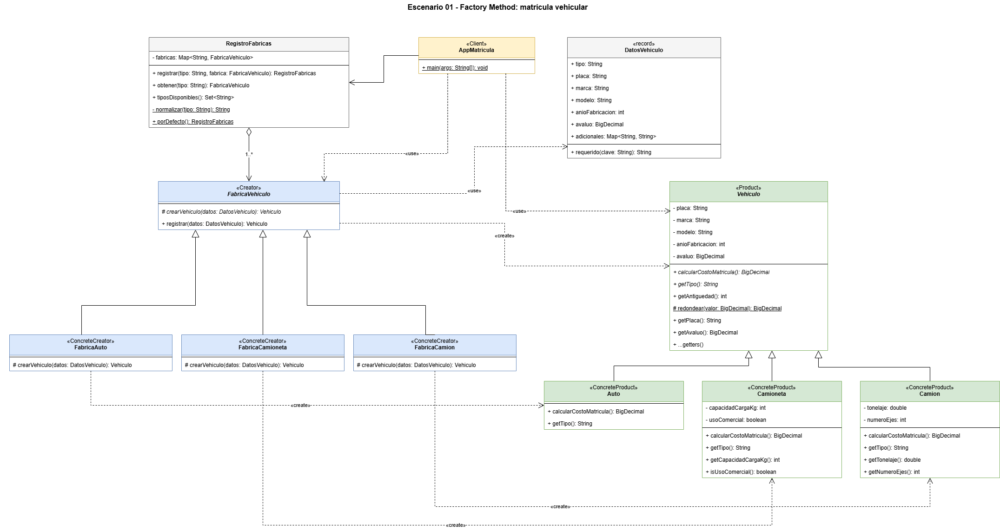
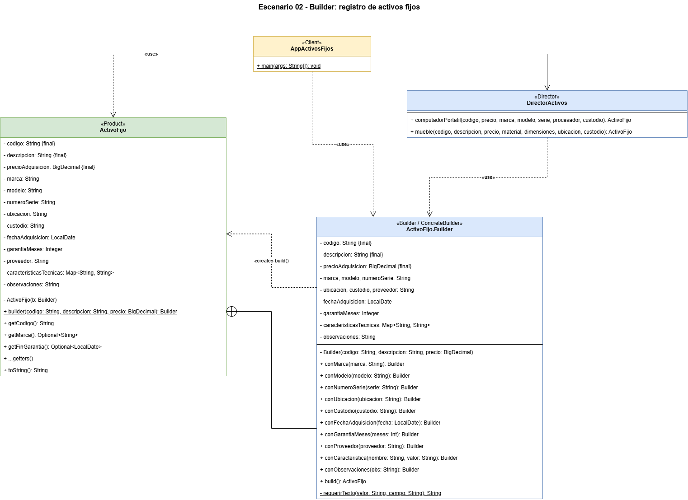

# PDS – Actividad 01: Patrones creacionales

**Maestría en Software – Universidad Politécnica Salesiana**
Asignatura: Patrones de Diseño de Software

**Grupo:** 8
**Integrantes:**
- Naranjo Rivadeneira Christian Alberto
- Loor Maridueña Jordy Alexander
- Mesias Velez Diego Calixto
- Cordova Calle Juan Jose

---

## Escenarios resueltos

| Escenario | Problema | Patrón | Paquete |
|---|---|---|---|
| 01 | Registrar vehículos y calcular su matrícula. El tipo concreto (Auto, Camioneta, Camión) se decide en tiempo de ejecución. | **Factory Method** | `escenario01` |
| 02 | Registrar activos fijos con 3 datos obligatorios y muchos opcionales que varían según el tipo de bien. | **Builder** | `escenario02` |

---

## Requisitos

- JDK 21

## Ejecución

**Desde VS Code:** abrir `AppMatricula.java` o `AppActivosFijos.java` y presionar ▶ Run.

**Desde la terminal (PowerShell):**

```powershell
javac -encoding UTF-8 -d out (Get-ChildItem -Recurse -Filter *.java src).FullName
java -cp out escenario01.AppMatricula
java -cp out escenario02.AppActivosFijos
```

**Con Maven:**

```bash
mvn compile
java -cp target/classes escenario01.AppMatricula
java -cp target/classes escenario02.AppActivosFijos
```

---

## Estructura del proyecto

```
src/main/java/
├── escenario01/                       Factory Method
│   ├── AppMatricula.java              Client
│   ├── fabrica/
│   │   ├── FabricaVehiculo.java       Creator (factory method: crearVehiculo)
│   │   ├── FabricaAuto.java           ConcreteCreator
│   │   ├── FabricaCamioneta.java      ConcreteCreator
│   │   ├── FabricaCamion.java         ConcreteCreator
│   │   └── RegistroFabricas.java      Selección de la fábrica en tiempo de ejecución
│   └── producto/
│       ├── Vehiculo.java              Product
│       ├── Auto.java                  ConcreteProduct
│       ├── Camioneta.java             ConcreteProduct
│       ├── Camion.java                ConcreteProduct
│       └── DatosVehiculo.java         Datos de entrada del cliente (record)
└── escenario02/                       Builder
    ├── ActivoFijo.java                Product + Builder (clase anidada)
    ├── DirectorActivos.java           Director
    └── AppActivosFijos.java           Client
diagramas/                             Diagramas UML (draw.io y PNG)
```

---

## Escenario 01 – Factory Method

La clase abstracta `FabricaVehiculo` declara el método fábrica `crearVehiculo()`, y cada fábrica concreta decide qué vehículo instanciar. El cliente trabaja solo con las abstracciones `FabricaVehiculo` y `Vehiculo`: no conoce `Auto`, `Camioneta` ni `Camion`.

`RegistroFabricas` asocia cada tipo con su fábrica mediante un `Map`, así que la selección en tiempo de ejecución no necesita `if` ni `switch`.

### Agregar un nuevo tipo de vehículo (ej. Motocicleta)

1. Crear `Motocicleta extends Vehiculo` con su propia `calcularCostoMatricula()`.
2. Crear `FabricaMotocicleta extends FabricaVehiculo`.
3. Registrarla en `RegistroFabricas.porDefecto()`:
   `.registrar("MOTOCICLETA", new FabricaMotocicleta())`

No se modifica `Vehiculo`, `FabricaVehiculo`, `DatosVehiculo` ni el cliente (principio Abierto/Cerrado). Los datos propios del nuevo tipo, como la cilindrada, viajan en el mapa `adicionales` de `DatosVehiculo`.



---

## Escenario 02 – Builder

`ActivoFijo` es inmutable y tiene su constructor privado: la única forma de crearlo es mediante `ActivoFijo.Builder`.

- Los **datos obligatorios** (código, descripción y precio) se exigen al inicio: `ActivoFijo.builder(codigo, descripcion, precio)`.
- Los **opcionales** se agregan con métodos de nombre explícito: `conMarca()`, `conCustodio()`, `conGarantiaMeses()`, etc.
- Las **características propias** de cada tipo de bien se agregan con `conCaracteristica(nombre, valor)`.
- `build()` valida las reglas de negocio y entrega el objeto terminado.

`DirectorActivos` encapsula configuraciones frecuentes (computador portátil, mueble).

```java
ActivoFijo mesa = ActivoFijo.builder("AF-002", "Mesa de reuniones", new BigDecimal("450.00"))
        .conCaracteristica("Material", "Madera MDF")
        .conCaracteristica("Dimensiones", "240 x 120 x 75 cm")
        .conUbicacion("Sala de reuniones 2")
        .conCustodio("Luis Pérez")
        .build();
```



---

> **Nota:** Las tarifas de matrícula son reglas ilustrativas para el ejercicio, no valores oficiales.